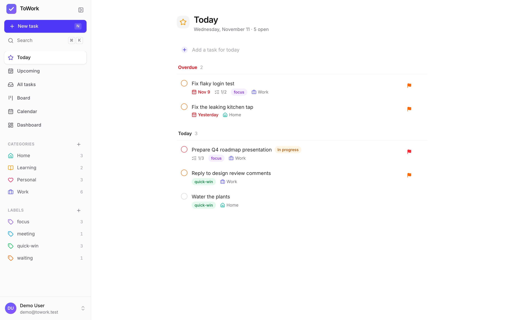
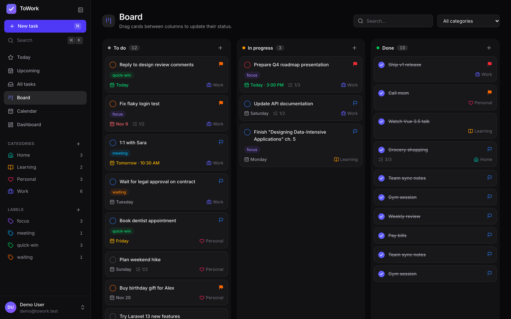
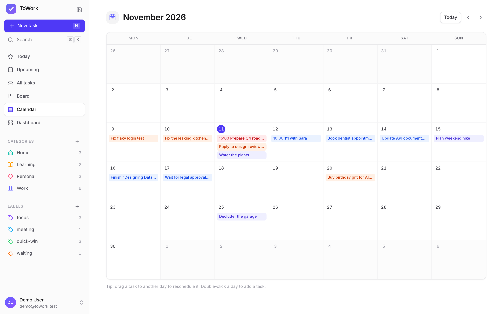
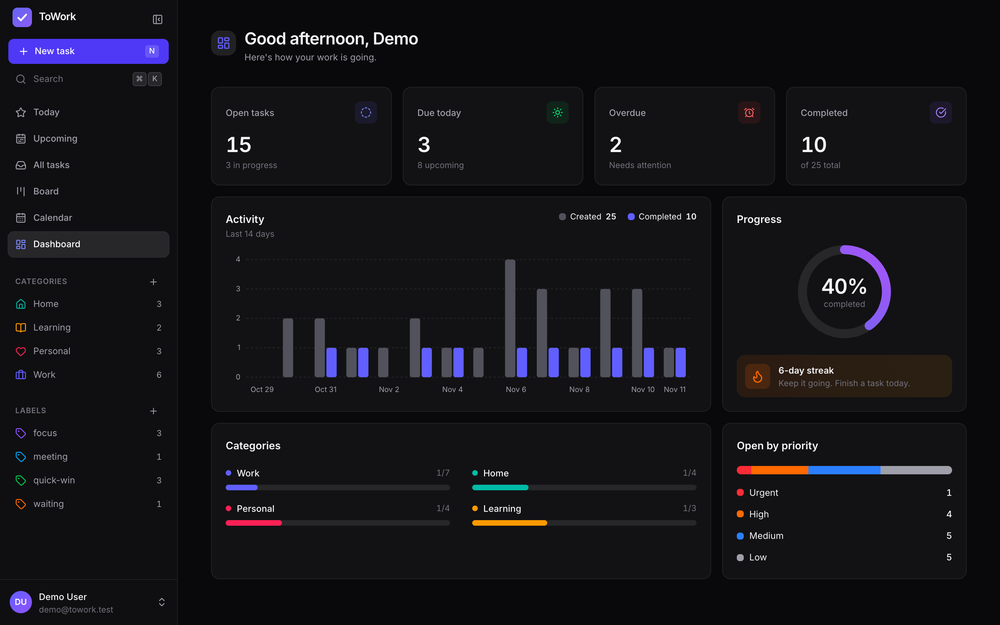

# ToWork: Next.js

ToWork is a free, open-source todo app. This repository is the **Next.js** frontend. It has the same features and design as [towork-vue](https://github.com/milwad-dev/towork-vue) and runs on the [towork-backend](https://github.com/milwad-dev/towork-backend) Laravel API.

Built with **Next.js 16** (App Router, Turbopack, Cache Components), **React 19**, **TypeScript**, **Tailwind CSS 4**, TanStack Query, dnd-kit and lucide-react.

## Screenshots

These show the light and dark themes with the seeded demo account.

| Today (light) | Board (dark) |
|---|---|
|  |  |
| **Calendar (light)** | **Dashboard (dark)** |
|  |  |

## Features

- 🔐 **Auth**: sign in with e-mail or phone, register (with a password strength meter), forgot password (e-mail → 6-digit code → new password) and e-mail verification. The token lives in an **httpOnly cookie**, so browser JavaScript can never read it.
- ✅ **Task lists**: Today (with Overdue), Upcoming, All tasks, and per-category and per-label views, with search, filters and sorting.
- ⚡ **Quick add** with natural language: `Call mom tomorrow !high #Personal @quick-win`.
- 📝 **Task drawer**: autosaves status, priority, due date and time, reminder, category, labels, description and subtasks.
- 🧲 **Kanban board** with drag and drop between To do, In progress and Done.
- 📅 **Calendar**: month grid; drag a task to reschedule it, or double-click a day to add one.
- 📊 **Dashboard**: stat cards, a 14-day activity chart, completion ring, streak, and category and priority breakdowns.
- ⌘K **command palette** and keyboard shortcuts (`n` new task, `/` search, `?` help, `g` + letter to navigate).
- 🌗 Light, dark and system themes without a flash of the wrong theme; responsive down to phones.
- 🐳 Docker image built on Next.js `standalone` output, running as a non-root user.

## Quick start with Docker

Start the API first:

```bash
git clone https://github.com/milwad-dev/towork-backend.git
cd towork-backend && docker compose up -d --build
```

Then start this app:

```bash
git clone https://github.com/milwad-dev/towork-next.git
cd towork-next && docker compose up -d --build
```

Open **http://localhost:3001** and sign in with the demo account: `demo@towork.test` / `password123`.

The compose settings are `TOWORK_NEXT_PORT`, `TOWORK_API_URL` and `TOWORK_COOKIE_SECURE` (see [`.env.example`](.env.example)). By default the container reaches the API at `http://host.docker.internal:8000/api/v1`.

## Local development

Requires Node.js 24+ and a running towork-backend.

```bash
npm install
cp .env.example .env.local
npm run dev          # http://localhost:3000
```

| Script | What it does |
|---|---|
| `npm run dev` | Development server (Turbopack) |
| `npm run build` / `npm start` | Production build / server |
| `npm run lint` | ESLint |
| `npm run format` / `format:check` | Prettier |
| `npm run typecheck` | Route type generation + `tsc --noEmit` |
| `npm run test` / `test:run` | Vitest (watch / once) |

## Architecture

```
Browser ──► Next.js (this app) ──► Laravel API (towork-backend)
            │
            ├─ /api/auth/login|register   sets the Sanctum token as an httpOnly cookie
            ├─ /api/auth/logout           revokes the token and clears the cookie
            ├─ /api/[...path]             proxies every other call, adding the Bearer token
            └─ src/proxy.ts               redirects guests to /login and signed-in users away from auth pages
```

- The browser **never** calls Laravel directly and never sees the token. `API_URL` is a server-only variable.
- When the API answers `401`, the proxy clears the cookie and the client sends the user back to `/login`.
- The client's `X-Timezone` header is forwarded, so "today", "overdue" and statistics follow the user's local day.
- Pages render their data on the client with TanStack Query, behind skeleton loaders, because "today" depends on the user's clock. The app shell is prerendered.

```
src/
├── app/            routes: (auth) and (app) route groups, api/ route handlers
├── components/     ui kit, app shell, tasks, board, calendar, dashboard, settings
├── hooks/          keyboard shortcuts and friends
├── lib/            API client, queries, quick-add parser, dates, types, server helpers
└── proxy.ts        route protection
```

## License

ToWork is open-source software licensed under the [MIT License](LICENSE).
